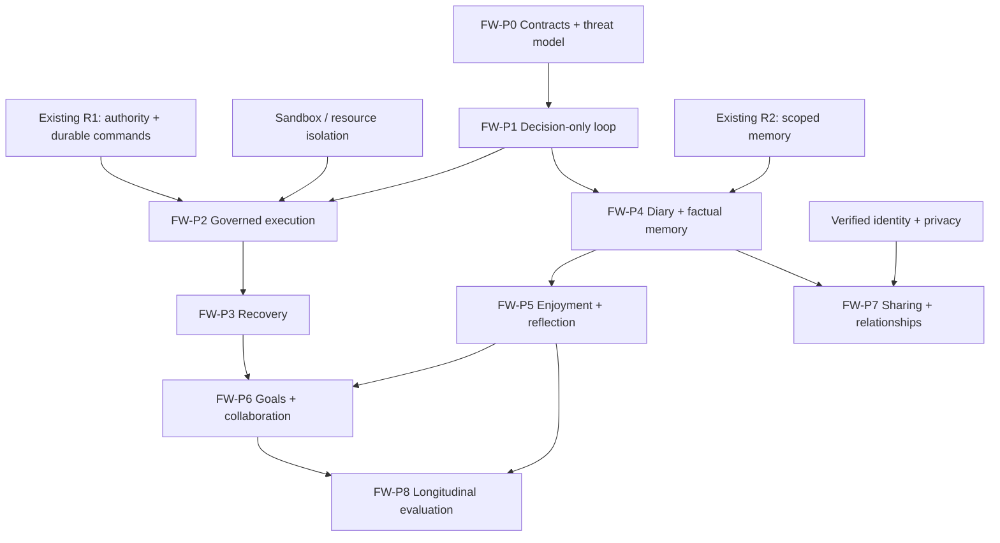

# Prizm Freewill — Repository-Aligned Development Roadmap

**Status:** Proposed implementation plan / readiness assessment (not a claim of completed feature work)  
**Reviewed target:** [`emaharmony/prizm`, `staging`](https://github.com/emaharmony/prizm/tree/staging)  
**Assessment date:** October 12, 2026  
**Companion product specification:** [`../concepts/PRIZM-FREEWILL-MODE-DESIGN.md`](../concepts/PRIZM-FREEWILL-MODE-DESIGN.md) (user-confirmed product decisions)
**Core invariant:** **Freewill owns intention proposals; Prizm runtime owns authorization, execution, persistence, and auditing.**

> **Conclusion:** Start Freewill engineering now with design contracts, a disabled-by-default observer / decision-only vertical slice, and non-destructive experiments. **Do not enable unattended write-capable Freewill** until durable execution, exact approval identity, sandbox isolation, recovery, and least-privilege controls pass dedicated acceptance tests.

> **Execution priority:** The [official Prizm roadmap](PRIZM_ROADMAP.md) remains authoritative for cross-track scheduling. The [agent handoff](../operations/FREEWILL_AGENT_HANDOFF.md) identifies the next eligible work and stop conditions. Existing `R1` remains active; begin `FW-001` in parallel only where it does not compete with active R1 work. See the integrated delivery table in the official roadmap.

## 1. Repository evidence and status caveats

This is a *document-and-source-structure review*, **not** an execution of the full suite or an independent proof that every component is production ready. Repository docs evolve, and some handoffs describe work on local branches rather than merged code. Recheck on the target commit before implementing each milestone.

| Source on `staging` | Finding / engineering consequence |
|---|---|
| [`docs/architecture/PRIZM_ROADMAP.md`](https://github.com/emaharmony/prizm/blob/staging/docs/architecture/PRIZM_ROADMAP.md) | R1 (governed coding and durable event delivery), R2/R6 (scoped memory/Recall), R3 (remote nodes), R4 (adapters/MCP events), R5/R7 (skills), R8 (champion/challenger) form the existing dependencies. No 9/10 readiness gate is established in this roadmap. |
| [`docs/operations/PLAN_OF_ACTION.md`](https://github.com/emaharmony/prizm/blob/staging/docs/operations/PLAN_OF_ACTION.md) | Current work centers on R1 durable command/outcome envelopes, SQLite outbox, idempotency, approval-bound patches, and recoverable worker acknowledgements. Treat local handoff claims as requiring verification on the implementation branch. |
| [`docs/reference/CAPABILITY_STATUS.md`](https://github.com/emaharmony/prizm/blob/staging/docs/reference/CAPABILITY_STATUS.md) | Scheduler, providers, delegation, Remembrance, and existing *Free Mode* are experimental. Do not assume they are mature production substrates. |
| [`docs/architecture/decisions/0001-runtime-owns-authority.md`](https://github.com/emaharmony/prizm/blob/staging/docs/architecture/decisions/0001-runtime-owns-authority.md) | Accepted architectural constraint: model outputs are untrusted; runtime owns policy, approvals, validation, persistence, and execution boundaries. |
| [`docs/architecture/PACKAGE_BOUNDARIES.md`](https://github.com/emaharmony/prizm/blob/staging/docs/architecture/PACKAGE_BOUNDARIES.md) | Package ownership must follow bounded domain/invariant, not convenience or file size. New package introductions require written justification. |
| [`docs/concepts/V-FREEDOM-MODE-DESIGN.md`](https://github.com/emaharmony/prizm/blob/staging/docs/concepts/V-FREEDOM-MODE-DESIGN.md) | Existing *Freedom / Free Mode* is an interactive, master-user-directed direct-tool-access mode. It is **not** Freewill. It bypasses some approvals for a trusted owner; do not reuse its privilege path for self-originated work. |
| [`internal/scheduler/scheduler.go`](https://github.com/emaharmony/prizm/blob/staging/internal/scheduler/scheduler.go); `cmd/prizm-cli/wake_handler.go` | Existing scheduled/event wake mechanisms are likely reusable, subject to deduplication and lease verification. |
| [`internal/approval/`](https://github.com/emaharmony/prizm/tree/staging/internal/approval), [`internal/policy/`](https://github.com/emaharmony/prizm/tree/staging/internal/policy), [`internal/tool/`](https://github.com/emaharmony/prizm/tree/staging/internal/tool) | Existing tool authority primitives. Extend through the same gates rather than letting new autonomy code call tools directly. |
| [`internal/memory/`](https://github.com/emaharmony/prizm/tree/staging/internal/memory), [`internal/remembrance/`](https://github.com/emaharmony/prizm/tree/staging/internal/remembrance) | Scoped memory, reflection sink, Recall/Remembrance wiring and tests provide a foundation. Durable reconciliation is not yet something to assume. |
| [`internal/commitments/`](https://github.com/emaharmony/prizm/tree/staging/internal/commitments) | Existing commitment records and follow-up delivery can help, but Freewill needs additional proposals/acceptance/revision/priority semantics. |
| [`internal/workflow/multiagent/`](https://github.com/emaharmony/prizm/tree/staging/internal/workflow/multiagent) | Durable authored/compiled workflows exist; use them for task execution rather than inventing another workflow executor. |
| [PR #87](https://github.com/emaharmony/prizm/pull/87) | At review time GitHub reported **merged**, improving R1 implementation. Merged != acceptance of every real-provider and restart gate. |
| [PR #86](https://github.com/emaharmony/prizm/pull/86) | At review time GitHub reported **open**, covering R6 Recall reconciliation. Design local-only durable capture first; treat remote reconciliation as a later integration gate. |

**Documentation divergence to resolve:** The old `PROJECT-CONTEXT.md` describes a pre-M1 / main-only state, whereas the current roadmap and plan describe newer R1 work on `staging`. Use the current roadmap, plan, source, and tested commit as the implementation baseline; update stale orientation docs through the normal repo process.

## 2. Explicit separation of operating modes

| Mode | Task origin | Privileges | Normal execution path |
|---|---|---|---|
| **Gated / standard** | User / configured workflow / scheduled command | Existing policy + approvals | Governed task or compiled graph |
| **Freedom / Free Mode** (existing) | Verified master user interacting directly | Owner-configured interactive privileges (higher risk) | Interactive tool loop; **never inherited by Freewill** |
| **Freewill** (new, experimental) | Agent-generated candidate → `IntentionRequest` | Default-deny **autonomy envelope**, workspace, per-tool policy, human escalation | Normal governed command/outcome/approval path |

**Never equate an agent asking to do something with a trusted user approving it.** A user chat saying “do it” must carry verified identity and scoped approval; a generated “reason” is not authority.

## 3. Prerequisite gates: what must be true before each kind of work

### G0 — Architecture and contract baseline (begin now)

- Freeze *locked product requirements* in the companion spec while labeling event schemas, command names, scoring formulas, thresholds, and storage layout as **proposed**.
- Define domain owners for intention lifecycle, choice/scoring, authorization, memory evidence, and presentations. Follow `PACKAGE_BOUNDARIES.md` and ADR 0001.
- Confirm one canonical command/outcome path, event identities, storage transaction boundaries and approval identity on the selected staging SHA.
- Distinguish `freewill.enabled`, `freewill.scheduling.enabled`, and separate human-verified emergency halt / disabling behavior.
- Specify telemetry data retention and interpretation policy, including decisions versus model-generated self-reports.

**Gate:** ADR + state transition table + machine-checkable event contracts reviewed; `freewill.enabled: false` changes no existing behavior.

### G1 — Governed execution and durable event delivery (blocking before unsupervised work)

Depends primarily on **R1**. Verify, do not assume:

- Every intention-triggered command has correlation / causation / idempotency identity and one queryable terminal outcome; producer/consumer duplicate delivery produces one effect.
- Exact approvals are bound to exact pending proposals and expected code/file state; edited proposals must be revalidated and re-approved as required.
- Atomic save/checkpoint/outbox behavior works through restart, lost worker, expired lease and disconnected bus.
- Worker execution respects deadline, resource envelope, tool authorization, and workspace boundaries; an already-authorized resume is reevaluated for current policy.
- Full relevant tests pass and at least one real-provider, real-repo, isolated-worktree recovery trace passes. Existing R1 roadmap 9/10 acceptance gate remains the target for broader rollout.

**Gate:** Repeatable approve → apply → validate → resume and kill/restart tests, no duplicate mutation, no bypass. This is a blocker for Freewill **mutations**, not for candidate generation, read-only planning, or mock execution.

### G2 — Isolation and autonomous safety policy (blocking before any write-capable Freewill)

- Establish an isolated execution workspace; use worktrees or per-run disposable dirs. Restrict writes by OS/container sandbox policy, not merely prompt rules or shell-string blocklists.
- Configurable allowed read roots; deny secrets, credentials, host configuration and all disallowed paths. Defend against symlinks, traversal, absolute paths and indirect tool effects.
- Restrict network egress and external services to explicitly allowed destinations; default-deny external publication, messages, pushes, installations or privileged operations.
- No inheritance of interactive **Freedom Mode** privileges. Authorization is determined for each operation from trusted runtime identity plus active policy and budget.
- Separate normal disable (finish/checkpoint) from immediate emergency halt. Add safety kill switch and failure-injection tests.

**Gate:** Path-escape, symlink, dangerous-command, environment-secret, cross-user scope, direct-shell and tool-chaining tests fail closed. No model-originated tool can disable these checks.

### G3 — Scoped and durable memory integrity (blocking before preference learning / diaries)

Depends on **R2**, with **R6** desirable before distributed or cross-provider reconciliation.

- Persist canonical executed facts separately from agent narrative/reflections, inferred preferences and relationship models.
- Key memory and events by agent, user, project, intention, and authorized scope; track source evidence IDs, confidence, versions and corrections.
- Provide a local durable store/fallback before relying on Recall availability; queue/reconcile memory delivery idempotently when R6 is ready.
- Ensure no unconsented relational profiling and no cross-tenant/agent access leakage through summaries, embeddings or search results.
- Define deletion and retention controls; distinguish redacted audit necessities from user-controlled personal information deletion.

**Gate:** Simulated Recall outage/restart does not lose local evidence or leak denied memories. Contradicted diary claims cannot silently overwrite executed facts.

### G4 — Verified identity for external controls (blocking for Discord / multi-user rollout)

- Start with local authenticated owner CLI in initial V1 if necessary.
- Before Discord writes, bind sender ID to a verified principal and require an additional authenticator for sensitive operations; role/nickname text is not authority.
- Implement least-privilege permissions and audited grant/revoke/expiry; do not launch third-party diary sharing or relational modeling until consent controls exist.
- Lock sensitive outputs to an authenticated private delivery channel and control replay/forward exposure as far as technically possible.

**Gate:** Impersonation, replay, revoked grants, unauthorized diary reads, mismatched Discord identity and over-delegation tests fail closed.

### G5 — Observation/research substrate (blocking before scientific claims, not before MVP)

- Record model/provider versions, prompt/config versions, seed where available, environment/tool versions, task difficulty, resource budgets and safety decisions.
- Define a fixed test battery and control condition; randomize or counterbalance comparisons when feasible, account for drift.
- Label “enjoyment”, “feelings”, and “personality” as model-generated appraisals/observed patterns, not evidence of subjective experience.
- Keep opt-in consent, third-party privacy and independently verifiable outcomes separate from diary narratives.

**Gate:** Experiment results can be re-run, inspected, and challenged; insufficient/inconclusive evidence remains explicitly inconclusive.

## 4. What is blocking and what is not

| Existing roadmap | Importance to Freewill | Blocking? |
|---|---|---|
| **R1: Governed approval, durable outbox and execution** | Avoids duplicated or unapproved autonomous effects | **Yes** for actual autonomous tool effects; no for read-only planning |
| **R2: Scoped memory** | Reliable agent-specific factual and narrative memory | **Yes** for reliable long-term learning/diary phases; initial local journal can precede complete R6 |
| **R6: Recall fallback / reconciliation** | Cross-session resilience when primary memory is unavailable | **Later gate** for distributed persistent learning; avoid gating read-only prototype on it |
| **R3: Cross-Prizm remote delegation** | Multi-node collaboration | **No** for single-node MVP |
| **R4: Adapter/MCP bus contract** | Safe event-trigger ecosystem | **Partial**; built-in triggers can start first, external adapters later |
| **R5/R7: Skill discovery/versioning** | Better task execution and provenance | **No** for core choice loop |
| **R8: Champion/challenger self-improvement** | Comparison and controlled self-modification | **No** for MVP; self-patching remains separately approved |
| Full RBAC / diary sharing | Multi-user privacy and external reach | **No** for owner-only, unshared, local MVP; **yes** for third-party access |
| Relational perception / forgiveness | Longitudinal social experiments | **No** for intention V1; after consent/privacy infrastructure |

## 5. Proposed development milestones and dependencies

This is the detailed **FW track** underneath the authoritative [`PRIZM_ROADMAP.md`](PRIZM_ROADMAP.md), not a second competing platform roadmap. Track them as an experimental initiative under the existing R1/R2/etc. commitments. Each PR should be small, testable, disabled by default, and mergeable without flipping autonomy on.

### FW-P0 — Contracts, threat model, and repo alignment

**Requires:** G0; immediately startable.  
**Build:** Spec-to-code mapping; state machine (`disabled`, `idle`, `waking`, `selecting`, `proposed`, `awaiting_approval`, `active`, `checkpointing`, `paused`, `completed`, `denied`, `halted`); typed `IntentionRequest`, choice rationale summary, wake source and envelope contracts; architecture decision distinguishing Freedom from Freewill.  
**Tests:** Schema validation, state-transition invariants, disabled-by-default regression tests.  
**Done when:** A developer can implement next milestone without defining missing authority or lifecycle semantics.

### FW-P1 — Read-only Decision Loop (first demonstrable Freewill)

**Requires:** FW-P0; reusable provider and scheduler paths; no write capability.  
**Build:** Config and CLI on/off/status; timer and allowed-trigger wake adapters; candidate generation (three new candidates + optional resume), sleep; scoring for curiosity, novelty, interests and obligations (initially stubbed); selection reason summary; policy-only dry-run for `IntentionRequest`.  
**Tests:** No wake while disabled, one wake per dedupe key, no task forced on sleep, no tool side effects, budget-limited model calls, event trace across selection.  
**Done when:** An agent autonomously considers ideas, chooses among them and sleep, and records a reproducible proposal without executing a write.

### FW-P2 — Authorized Execution in Isolated Workspace

**Requires:** G1 + G2.  
**Build:** Intention approval/edit/deny/exceptions; exact capability grants; dedicated `.prism/autonomous` (or final configured) workspace, per-run isolated worktree/container; guarded dispatch to existing workflow engine and tool policy; user review through authenticated CLI; resource meter and immediate halt.  
**Tests:** edited scope rechecks; forbidden tool denied; escapes/privilege escalation blocked; rejected intent never executes; one approved change applies once.  
**Done when:** One small autonomous coding/research project starts by agent choice, is approved as needed, executes only within its exact envelope, and produces a validated report.

### FW-P3 — Persistence, Lifecycle, and Recovery

**Requires:** FW-P2 + G1.  
**Build:** Durable intention record, checkpoint/resume across wake cycles, safe disable, dedupe, lease ownership, cancellation; verification/reconciliation of ambiguous side effects; budget renewal requests; status and trace inspection.  
**Tests:** power loss at each state boundary, repeat event delivery, expiry/revocation during resume, store/outbox failure, no duplicate external action.  
**Done when:** A multi-session intention survives restart; no unauthorized or double action occurs.

### FW-P4 — Factual Memory + Agent Diary (local-first)

**Requires:** G3, FW-P1; optimized once FW-P3 available.  
**Build:** Local evidence ledger, summary capture, distinct self-report narrative, append-only/versioned diary entries and annotations, snapshot metadata, configurable visibility and owner-only reads, privacy redaction. Then integrate R2/R6 when proven.  
**Tests:** contradictory diary and logs preserved; provenance respected; memory denied outside scope; local storage survives memory-provider outage.  
**Done when:** An owner can follow an intention from executed facts to an agent's revisable diary interpretation across restarts.

### FW-P5 — Enjoyment Telemetry, Reflection Probe Engine, and Learning

**Requires:** FW-P4, stable telemetry source and provider.  
**Build:** Self-assessment + behavioral measurements, separate immediate/trend/historical preferences, prediction surprise, negative-experience attribution, question budgets, agent challenges, confidence calibration, strategy experiments and learning hypotheses; candidate-ranking influences but **never** tool authority.  
**Tests:** inconsistent self-reports reduce confidence; learning only promoted after repeated evidence; evidence version history stays inspectable; reflection respects token budget and avoids recursive infinite loops.  
**Done when:** Later candidate choices can be explained using actual prior evidence and provisional preference state.

### FW-P6 — Persistent Goals, Commitments, and Collaboration

**Requires:** FW-P3 + FW-P5, plus suitable existing governed delegation.  
**Build:** Revocable long-term goals/subgoals, self-development suggestions and evidence, contextual resilience and transfer, balanced priority scoring, adaptive preemption, checkpoint/resume, promises and negotiated renegotiation, authorized agent assistance, collaboration attribution.  
**Tests:** no priority switch silently alters a user promise; preempted tasks resume from checkpoint; delegation does not widen effective permissions; conflicting commitments produce transparent resolution.  
**Done when:** An agent manages two competing goals and one user obligation over multiple cycles with a complete, safe trace.

### FW-P7 — Identity, RBAC, Diary Sharing, and Relational Perception

**Requires:** G4 + FW-P4 + reliable privacy controls; security review.  
**Build:** Secure local superuser bootstrap; principal binding for CLI/Discord; scoped/time-limited delegation, break-glass inspection; per-entry frozen-view sharing/excerpts/collections and revocation; optional consented per-user opinions/appraisals, agent disagreement, challenges, contextual forgiveness.  
**Tests:** forged owner / role spoof denied; private diary accidental leak denied; expired grants denied; consent withdrawal stops profiling; forgiveness does not erase required safety records; third-party data boundaries intact.  
**Done when:** Multi-user interaction is auditable and privacy-safe; opt-out works and privilege cannot be self-granted.

### FW-P8 — Controlled Longitudinal Experimental Platform

**Requires:** G5 + FW-P5 minimum; richer tests benefit from FW-P6/P7.  
**Build:** Experiment groups, clean-slate vs seeded agent comparisons, control agent with same runtime, frozen prompts/providers or tracked changes, repeated tasks, snapshots, trace replays, uncertainty calibration analysis, reliability and preference stability reports.  
**Tests:** reproducible battery, retention limits and privacy checks, blinded outcome scoring where possible, no subjective-experience claim inferred from agent self-report.  
**Done when:** An external reviewer can understand what changed, what evidence supports it, and what alternative explanations remain.

### Dependency picture

## 6. Immediate backlog: first four small pull requests

| Proposed PR | Content | Acceptance / no-go condition |
|---|---|---|
| **FW-001: Architecture + schemas** | Add Freewill ADR, config schema `enabled: false`, intention/decision DTOs, proposal/sleep/wake states and focused validation tests. | No tools ever run by parsing a candidate. Existing gated/Freedom behavior unchanged. |
| **FW-002: Scheduler / wake adapter** | Safe triggering through current scheduler and event path, debounced/leased; list allowed triggers; `status` command. | Disabled means no wakes; repeated message/event does not double-select; crash during wake doesn't create orphan run. |
| **FW-003: Three-candidate chooser** | Provider-backed or fixture-backed 3 novel candidates + optional resume + sleep, explainable scoring, saved proposed intention. | No network/file mutation; mocked evaluation deterministic; decision trace includes alternatives and budget. |
| **FW-004: Gate-only integration** | Map `IntentionRequest` through normal policy/approval evaluation, including edited request and denial; no automatic execute. | Every denied request is final and queryable; edit invalidates prior approval; fails closed if policy service unavailable. |

**First usable demonstration:** `prizm freewill dry-run --agent <id>` causes a controlled wake, returns three candidate intentions (plus an optional resume candidate), demonstrates `sleep`, records the selected proposal and why, displays the policy decision, and performs **zero external or filesystem mutations**. Command spelling is illustrative, not yet implemented.

## 7. Acceptance checklist before advancing to unattended execution

- [ ] Existing R1 tests and fresh governed real-run recovery demonstrate no unapproved or duplicate effects.
- [ ] Freewill cannot inherit `channel_roles.mode: free` privilege or shell master-user status.
- [ ] Write-capable processes are isolated from host secrets, unrestricted network, and out-of-scope paths (including traversal/symlinks).
- [ ] Every action is governed by runtime policy and exact scoped capability grant, even after a restart or user edit.
- [ ] Idle/disabled/sleep/halt states are honored; timer and event wake triggers are bounded and deduplicated.
- [ ] Resource ceilings cannot be bypassed via new subtasks, delegated agents or additional provider calls.
- [ ] Checkpoint/recovery reconciles uncertain side effects rather than reissuing them blindly.
- [ ] Run, intention, and decision traces distinguish evidence from generated narratives.
- [ ] Privileged CLI/Discord access is verified, scoped and audited before remotely enabling mutations.
- [ ] Dedicated regression tests for privacy, prompt injection and out-of-scope action rejection pass.

## 8. Proposed package and integration ownership (validate against code)

| Responsibility | Best initial owner / seam | Architectural note |
|---|---|---|
| Candidate decision and intention lifecycle | New `internal/freewill` only if a standalone bounded domain passes package justification; otherwise evaluate existing agent/task ownership first | Domain doesn't execute tools; calls command acceptance API |
| Timed / event triggers | `internal/scheduler`, wake intake and typed command path | Timer is a proposal producer, not an authority source |
| Policy and approvals | `internal/policy`, `internal/approval`, `internal/tool` | Never duplicate policy decisions in a prompt or agent-scoring function |
| Durable intent persistence / event projection | Current canonical event/outbox and persistence boundary | New events require identity, scope, idempotency, terminal state |
| Running tasks / agent delegation | `internal/workflow/multiagent`, `internal/agent`, `internal/subagent` | Reuse governed state machine and worktree isolation |
| Factual/scoped memory | `internal/memory`, `internal/remembrance` | Recall integration after local-first evidence contract |
| Commitments and notifications | `internal/commitments`, CLI/Discord adapter | Explicit user acceptance for changed user promises |
| Diary/relational privacy and RBAC | Proposed separate bounded domains when ready | Keep security enforcement runtime-side and privacy per principal |
| Human command surfaces | `cmd/prizm-cli`, Discord adapter / API composition | Presentation never owns domain authorization |

**Existing repo process:** Read `AGENTS.md`, `docs/architecture/PACKAGE_BOUNDARIES.md`, `docs/architecture/PRIZM_ROADMAP.md`, `docs/operations/PLAN_OF_ACTION.md` and latest `docs/operations/WORK_LOG.md` before PR work. Update plan handoff/work log with evidence and next action. Do not create a parallel untracked roadmap or bypass R1 priority without an explicit reprioritization decision.

## 9. Unresolved technical decisions (not changes to the locked product vision)

1. Whether single-agent intent state belongs in a new bounded domain or can be expressed through the existing task/run model without conceptual coupling.
2. Which durable store (existing SQLite projection/outbox versus purpose-built scoped journal table) owns intention state; event facts stay canonical either way.
3. Exact write isolation mechanism across Windows/macOS/Linux (worktree alone is **not** sufficient sandboxing for shell/network/secrets).
4. Safe trigger idempotency/lease ownership when scheduler, Discord and bus can wake concurrently.
5. Initial local-only identity scheme and how Discord account linking and break-glass confirmation will work.
6. How to calibrate behavioral preferences and confidence without interpreting model-written diaries as verified evidence.
7. Which experiments run under fixed model/prompt versions versus tracked production-like drift.

## 10. Recommendation and next action

**Begin with FW-P0 and FW-001 today**, in a branch from current `staging`. This can proceed even while R1 and R6 mature. Then implement FW-P1 as a **read-only, policy-aware** vertical slice. Only start FW-P2 after G1 and G2 acceptance tests pass; preserve every locked user decision in the companion spec and keep the entire feature behind `experimental.freewill.enabled: false` until explicit local opt-in.

The roadmap is a planning artifact. It does not represent new commits, PRs, passing test results or enabled runtime features.